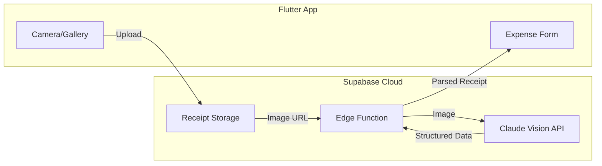

# Receipt Scanning Implementation Plan

## Architecture Overview



**Flow:**
1. User captures receipt with camera or picks from gallery
2. Image uploads to Supabase Storage
3. Edge Function sends image URL to Claude Vision API
4. Claude returns structured data (merchant, date, amount, category, line items)
5. Pre-filled expense form for user confirmation

---

## Implementation Details

### 1. Dependencies and Configuration

**Add to `pubspec.yaml`:**
- `image_picker` - camera/gallery access

**iOS Configuration (`Podfile`):**
- Set minimum iOS platform to 15.5

**Android Configuration:**
- No special config needed

---

### 2. Receipt Scanning Service

Create `lib/services/receipt_scanning_service.dart`:
- `uploadReceiptImage(File imageFile, String tripId)` - uploads to Supabase Storage
- `parseReceiptWithAI(String imageUrl)` - calls Edge Function with image URL
- `scanReceipt(File imageFile, String tripId)` - uploads then parses
- Returns `ParsedReceipt` model with: merchant, date, amount, currency, category, lineItems, confidence

---

### 3. Supabase Edge Function

Create `supabase/functions/parse-receipt/index.ts`:
- Accepts: receipt image URL
- Calls Claude Vision API with structured prompt
- Returns JSON with extracted fields
- Handles errors gracefully (returns partial data with confidence scores)

**Prompt Strategy:**
- Send image URL to Claude Vision API
- Request structured JSON output with fields: merchant, date, total, currency, category, line_items
- Include Filipino context (PHP currency, local merchants like Jollibee, SM, etc.)

---

### 4. UI Components

**New Files:**

`lib/screens/scan_receipt_screen.dart`:
- Camera preview with capture button
- Gallery picker option
- Processing state with progress indicator
- Preview extracted data before proceeding

`lib/widgets/receipt_preview_card.dart`:
- Shows receipt image thumbnail
- Displays extracted data (amount, merchant, date)
- Edit button to correct OCR mistakes

**Modify:**

`lib/screens/add_edit_expense_screen.dart`:
- Add "Scan Receipt" button at top of form
- Accept pre-filled data from scan flow
- Store receipt image URL in `receiptUrl` field (already exists in model)

---

### 5. Data Models

Create `lib/models/parsed_receipt.dart`:

```dart
class ParsedReceipt {
  final String? merchant;
  final DateTime? date;
  final double? amount;
  final String? currency;
  final ExpenseCategory? suggestedCategory;
  final List<ReceiptLineItem>? lineItems;
  final double confidence;
  final String? receiptUrl;
}

class ReceiptLineItem {
  final String description;
  final double? quantity;
  final double? price;
}
```

---

### 6. Security Considerations

- OpenAI API key stored in Supabase Edge Function environment (never in app)
- Edge Function validates user is authenticated
- Receipt images stored in private Supabase Storage bucket
- RLS policies ensure users can only access their own receipts

---

## Key Files Created/Modified

| File | Action |
|------|--------|
| `pubspec.yaml` | Added image_picker |
| `ios/Podfile` | Set platform to iOS 15.5 |
| `lib/models/parsed_receipt.dart` | New - data model |
| `lib/services/receipt_scanning_service.dart` | New - upload + AI parsing |
| `lib/screens/scan_receipt_screen.dart` | New - camera UI |
| `lib/screens/add_edit_expense_screen.dart` | Modified - added scan button |
| `supabase/functions/parse-receipt/index.ts` | New - Edge Function |
| `supabase/migrations/012_receipts_storage.sql` | New - Storage bucket |

---

## Deployment Steps

1. **Create the receipts storage bucket** - Run the migration `012_receipts_storage.sql` in Supabase SQL Editor

2. **Deploy the Edge Function**:
   ```bash
   supabase functions deploy parse-receipt
   ```

3. **Set the Anthropic API key** (for Claude Vision):
   ```bash
   supabase secrets set ANTHROPIC_API_KEY=sk-ant-your-key-here
   ```

4. **Rebuild iOS** - Run pod install:
   ```bash
   cd lakwatsapp/ios && pod install
   ```

---

## Recent Enhancements

### Expense Split Integration (April 7, 2026)

The receipt scanning flow now includes expense split selection:

1. User scans receipt
2. AI extracts merchant, amount, date, category
3. **NEW:** User can configure expense split directly in ScanReceiptScreen
4. User confirms and data is passed to expense form with split pre-configured

This creates a seamless flow from scanning to splitting without extra steps.

**Files Modified:**
- `lib/screens/scan_receipt_screen.dart` - Added `ExpenseSplitSelector` widget and `ScanReceiptResult` wrapper class
- `lib/screens/add_edit_expense_screen.dart` - Updated to handle `ScanReceiptResult` with split data

---

*Last updated: April 7, 2026 — Removed Google ML Kit for iOS 26 compatibility*
